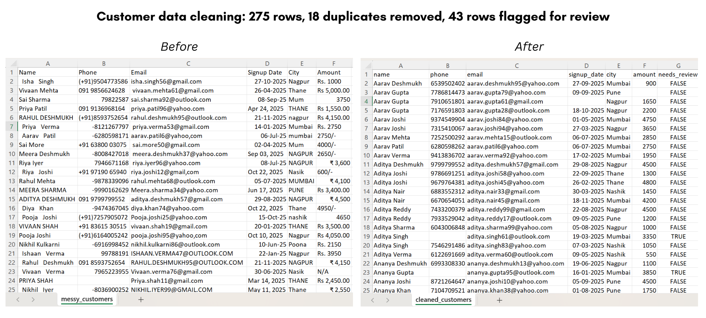

# Customer Data Cleaning Sample

A messy customer list (275 rows, fake data) cleaned with Python and pandas.

**Fixes:** inconsistent names, phone formats, email typos, mixed date formats,
city spellings, currency symbols and duplicates. Rows with missing contact
details are flagged for review.

**Result:** 275 rows in, 257 out, 18 duplicates removed, 43 rows flagged.

**Run it:**
python clean_data.py messy_customers.csv cleaned_customers.csv
